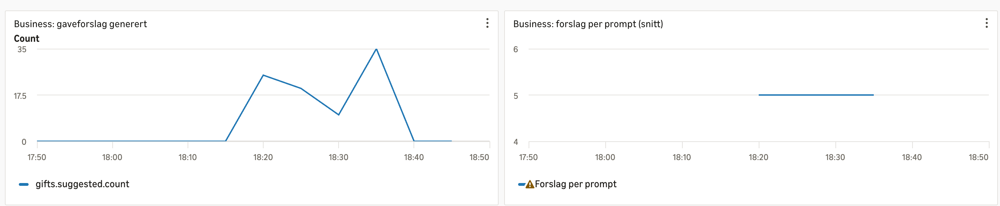
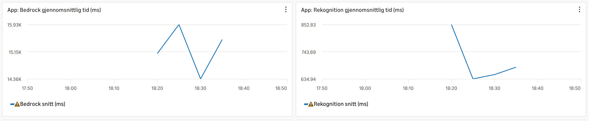

# PGR301-DevOps

Kandidatnummer: 26

## Oppgave 1 - Container og CI

### 1A - Dockerfile

Det ligger en multi-stage Dockerfile i prosjektmappen.
Starte containteren på `localhost:9999`:

```bash
docker build -t wishifai .
docker run -p 9999:8080 \
  -e AWS_ACCESS_KEY_ID \
  -e AWS_SECRET_ACCESS_KEY \
  -e AWS_REGION=eu-west-1 \
  -e S3_BUCKET=<bucketname> \
  wishifai
```

### 1B - CI-pipeline

Workflow: `.github/workflows/docker.yml`. Den kjører kun ved push til `main`, logger inn mot AWS med Github Secrets, bygger imaget og pusher til ECR.

Lenke til grønn kjøring: https://github.com/conradsandaunet/PGR301-DevOps/actions/runs/42629366743.

**Tagging-stragegi:** Imaget tagges med full commit-SHA.
Begrunnelse:
- Hver tag peker på nøyaktig en commit, så det er mulig å spore hva som kjører hvor.
- ECR-repoet har immutable tags, så en SHA-tag kan aldri overskrives ved et uhell.
- Rollback gjøres ved å deploye en tidligere SHA.


## Oppgave 2 - ECS Express og Terraform

### 2A - Infrastruktur

All Terraform ligger i `infra/`.
Offentlig URL: https://wi-e582d58f423745aaafcb903a25f14ffa.ecs.eu-west-1.on.aws

Valg og begrunnelser:
- **Eksisterende roller:** Execution role og infrastructure role er hentet fra klassens konto, som oppgaven ba om.
- **Task role:** Egen rolle `wishifai-task-26` (kandidatnummer som suffiks) med kun nødvendige tillatelser til S3, Rekognition, Bedrock og CloudWatch. Credentials kommer fra rollen, så ingen nøkler ligger i containeren.
- **S3 og miljøvariabel:** Bøtta `wishifai-26` opprettes av Terraform, og navnet settes automatisk som miljøvariabelen `S3_BUCKET` i containeren, så applikasjonen alltid bruker riktig bøtte.
- **Variabler:** `region`, `candidate`, `image_tag` og `bedrock_model_id`.
- **Output:** `service_url`, `bucket_name`, `task_role_arn`.

Kjøre koden:

```bash
cd infra
terraform init
terraform apply -var="candidate=26" -var="image_tag=<commit-SHA>"
```

### 2B - Remote state

State ligger i S3-bøtta `pgr301-terraform-state` med nøkkel:

```
wishifai/26/terraform.tfstate
```

Begrunnelse:
- Bøtta deles av klassen, så kandidatnummer i nøkkelen gjør at state-filen er unik.
- Kandidatnummer er hardkodet fordi `backend`-blokken ikke støtter variabler.

### 2C - Github Actions-job

Workflow: `.github/workflows/docker.yml` har to jobs:
1. `build-and-push` bygger og pusher imaget til ECR
2. `terraform` har `needs: build-and-push`, og kjører `fmt -check`, `init`, `validate` og `apply` mot `/infra`.

Lenke til grønn kjøring: https://github.com/conradsandaunet/PGR301-DevOps/actions/runs/43033394191.

Det er fornuftig at Terraform kjører etter container-build fordi Terraform refererer til en bestemt image-tag. Hvis Terraform
kjørte før eller parallelt, kunne tjenesten peke på et image som ikke finnes enda, og deploy ville feilet.
Etter build er imaget garantert i ECR, så det som deployes er det som ble bygget fra akkurat den commiten.
Hvis build feiler, stoppes pipelinen før noe infrastruktur endres.

## Oppgave 3 - Observability

### 3A - Metrics

**Metrics og hvorfor:**

- **Timere på de to eksterne kallene:** Rekognition og Bedrock er de dyre og trege delene av forespørselen. I testene mine brukte Rekognition under ett sekund, mens Bedrock brukte rundt 16 sekunder per kall. Timerne viser at Bedrock er flaskehalsen.
- **`gifts.suggested` (business-metric):** Teller hvor mye verdi tjenesten faktisk leverer, altså antall gaveforslag brukerne får. Den sier noe om bruk, ikke bare teknisk helse.
- **`gifts.per.prompt`:** Prompten ber om inntil fem forslag. Fordelingen viser om modellen leverer færre enn forventet, som er en kvalitetsindikator.
- **`bedrock.parse.failures`:** Modellen skal svare med gyldig JSON, men det er ikke alltid garantert. Telleren viser hvor ofte appen faller tilbake til "ukjent format", og fanger opp endringer i modellatferd.

### 3B - Dashboard og alarm

Kode for dashboard og alarm ligger i `infra/monitoring.tf`.

**Metrikkene på dashboard**

- Business; `gifts.suggested` (Sum); Viser hvor mye verdi tjenesten leverer, altså antall gaveforslag.
- Business; `gifts.per.prompt` (sum/count); Snitt forslag per prompt. Viser om modellen leverer det vi ber om.
- Applikasjon; `bedrock.converse.duration` (sum/count); Gjennomsnittlig Bedrock-tid. Det tregeste leddet.
- Applikasjon; `rekognition.detectlabels.duration` (sum/count); Gjennomsnittlig Rekognition-tid.
- Applikasjon; `jvm.gc.overhead`; Viser om garbage collection spiser CPU-tid, en tidlig indikator på minneproblemer.
- Infrastruktur; `CPUUtilization` og `MemoryUtilization`; Viser om tjenesten er over- eller underdimensjonert.

**Alarm: `wishifai-parse-failures-26`**

- **Hva den varsler på:** `bedrock.parse.failures.count` ≥ 1 i løpet av 5 minutter.
- **Hvorfor:** Modellen kan gi et svar som ikke kan parses som JSON, og det er et ubrukelig resultat. Appen faller da tilbake til et "ukjent format"-svar uten å kaste en feil. Så problemet vises ikke i en vanlig feilstatistikk. Dette fanger opp noe standard helsesjekk ikke ser.
- **Terskel og periode:** Én parsefeil er nok til å varsle, siden hvert tilfelle er en dårlig brukeropplevelse og trafikken er lav. Et vindu på 5 minutter gir en rolig evaluering, slik at alarmen ikke flakker, men fortsatt reagerer raskt nok.
- **Manglende data:** `treat_missing_data = notBreaching`, fordi ingen trafikk ikke betyr feil.
- **Varsling:** Alarmen sender til et SNS-topic. E-postabonnement er valgfritt.

**Skjermbilder av dashboard:**



## Oppgave 4 - Drøfting

### Innledning

En AI-applikasjon kan fungere teknisk (HTTP, grønne tester osv.) og likevel gi feil svar. Det er derfor viktig å måle kvalitet, og strengheten må skaleres med konsekvensene.

### Testing og kvalitetssikring

Vanlige enhetstester er ikke nok, fordi svaret varierer fra kall til kall. Man kan i stedet bruke f.eks. et fast eval-sett med bilder, og sjekke at svaret alltid kan parses og har riktig struktur. I min løsning måler jeg parsefeil via `bedrock.parse.failures`.

### Kontinuerlig leveranse

I Wishifai kan tre ting endres uavhengig av hverandre: koden, prompten og modellen. En endring i en av dem kan endre hva brukeren får som svar, selv om de vanlige testene fortsatt er grønne. Derfor må prompt og modell behandles som versjonerte artefakter, ikke bare vanlige tekststrenger. Fordi effekten av en endring er vanskelig å forutsi, bør den rulles ut gradvis med for eksempel canary, feature flag eller A/B-test. Rollback er enkelt for kode (ny commit-SHA), men for prompt og modell krever det at de er versjonert og logget. Det gjør ikke Wishifai i dag. Et naturlig steg videre er å logge modell-ID og promptversjon sammen med hvert svar.

### Overvåking

Latency og feilrater sier lite om kvaliteten i en LLM-tjeneste, fordi et raskt 200-svar kan være dårlig. Jeg ville i tillegg overvåket token-forbruk og kostnad, siden ineffektiv eller ukontrollert bruk raskt kan gi høye kostnader. Det kan også avsløre dårlig prompt-design, f.eks. for lange eller overflødige prompts. I Wishifai måler jeg varighet for Bedrock og Rekognition, antall forslag og parsefeil, men jeg mangler f.eks. token-forbruk og kostnader.

Kvalitetsregresjon kan oppdages ved å sammenligne metrikkene mot en baseline, og ved å merke metrikkene med prompt- og modellversjon, slik at man ser om et avvik begynner etter en bestemt endring. Man kan i tillegg kjøre et fast sett med testbilder jevnlig mot produksjon og sjekke at svarene fortsatt har riktig struktur og kvalitet.

### Gates før prod og feil som oppdages i prod

**Feil som må fanges opp før «prod»:**

- Bygg og enhetstester som må være grønne.
- `terraform fmt -check` og `validate`/`plan`, slik at infrastrukturen ikke er ødelagt.
- Sikkerhetsfiltre og policy, slik at svar ikke inneholder upassende innhold.

  **Feil man kan oppdage i «prod»:**

- Subjektiv kvalitet, som kjedelige forslag, lite treffende eller ikke helt passende for bildet.
- Små variasjoner i svarlengde, tone og kostnad.

### Risiko og skalering

For en gaveliste som Wishifai er konsekvensene av en dårlig respons små, så lettere gates og overvåking passer fint. Men for applikasjoner rundt bank, helse eller jus ville jeg krevd strengere overvåking, f.eks. flere og strengere alarmer i tilfelle ting ikke går som det skal. Samt menneskelig godkjenning på de mest kritiske områdene.

### Konklusjon

Kontinuerlig leveranse av LLM-baserte tjenester følger de samme prinsippene som annen programvare, men kontrollene må utvides til å gjelde prompts og modeller, ikke bare kode. Hvor strenge gates og overvåking bør være, avhenger av konsekvensene av feil. For Wishifai kan rask utrulling og lettere gates og overvåking aksepteres, mens bank, helse og jus krever strengere krav og menneskelig godkjenning.